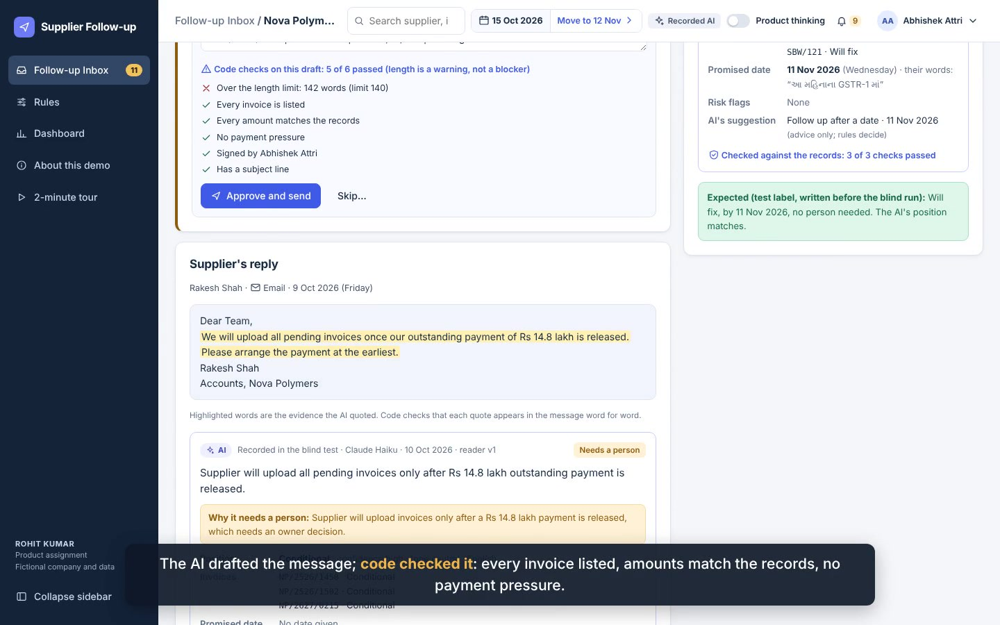

# GST Supplier Follow-up AI Agent

**From invoice mismatches to supplier action: AI-assisted follow-ups, human oversight and evidence-based resolution tracking.**

An AI product management case study by **Rohit Kumar**, covering problem framing, workflow design, prompt engineering, model evaluation, business impact modelling and a working browser application.



**Explore:** [Product deck](docs/files/Product_Deck.pdf) · [101-second walkthrough](docs/files/Walkthrough.mp4) · [Case study](docs/CASE_STUDY.md) · [Downloadable demo](docs/index.html)

## The product opportunity

GST reconciliation identifies invoice mismatches. Resolving them requires a second workflow: contacting suppliers, interpreting replies, tracking commitments, coordinating internal decisions and checking filing evidence.

The Supplier Follow-up AI Agent brings the supplier conversation, invoice context and next action into one workspace. Its central hypothesis is that better coordination can reduce manual follow-up effort and improve timely mismatch resolution.

**Target user:** GST operations teams managing supplier exceptions across multiple invoices and communication channels.

## Core product capabilities

| Capability | Workflow |
| --- | --- |
| Supplier case management | Review 16 supplier cases and 29 invoices in the synthetic demo dataset |
| AI reply analysis | Extract supplier intent, commitments, invoice references and escalation signals |
| Follow-up drafting | Prepare contextual messages using the case history and invoice evidence |
| Human approval workflows | Review proposed actions and handle judgement-heavy exceptions |
| Commitment tracking | Follow promises, reminders, missed dates and case history |
| Filing evidence tracking | Compare supplier claims with simulated IMS and GSTR-2B records |
| Case summaries and Q&A | Review concise updates and ask questions about supplier records |

The application demonstrates these workflows with synthetic data and recorded AI responses. Live AI execution depends on the Claude host; outbound messaging and GST portal integrations are simulated.

## My role and contribution

I selected the problem, defined the scope and constraints, designed the workflow and made the product decisions. I used Claude to assist with research, code implementation, prompt design, synthetic evaluation data and documentation.

| Product responsibility | Evidence in this repository |
| --- | --- |
| Problem selection and prioritisation | Product case study and decision log |
| MVP scope and exception handling | Product document and interactive workflow |
| AI task design | Reader, drafter, summary and Q&A prompts |
| Evaluation and model trade-offs | 40-reply synthetic dataset, saved outputs and scoring scripts |
| Commercial reasoning | Assumption-driven impact workbook and scenario analysis |
| Rollout planning | Human approval, shadow-mode validation and staged automation proposal |

## Key product decisions

- **Separate language tasks from financial logic.** AI interprets and drafts; code calculates amounts and derives case state.
- **Verify supplier claims against filing evidence.** A message saying “fixed” does not by itself close the mismatch.
- **Keep human judgement in the workflow.** Disputes, conditions, ambiguous replies and relationship-sensitive cases require review.
- **Make evaluation inspectable.** Prompts, synthetic labels, saved outputs and scoring code are available alongside the application.
- **Model value before claiming outcomes.** Avoided loss, faster resolution, staff capacity and willingness to pay remain assumptions to validate.

## Evaluation and business evidence

| Evidence | What it establishes |
| --- | --- |
| 40 synthetic supplier replies across five languages | An initial test set for reply interpretation and routing; language coverage is uneven |
| Saved responses from three model tiers | A basis for comparing behaviour and escalation trade-offs |
| 19 of 20 human-review cases detected in the original saved evaluation | The missed frustrated reply prompted a stronger human-review guard; updated metrics require a fresh evaluation run |
| Cautious, likely and strong business scenarios | A transparent model of potential value, rather than measured customer results |

The likely scenario estimates approximately **₹15.83 lakh in annual value per customer** against an assumed **₹2 lakh annual price**. This is an illustrative projection, dominated by the assumed reduction in credit loss. The workbook's AI-cost scenario links and cohort assumptions require the corrections documented in the [technical review](docs/LIMITATIONS.md).

## Product documentation

| Document | Purpose |
| --- | --- |
| [Product case study](docs/CASE_STUDY.md) | Problem, scope, decisions, evidence and next steps |
| [Six-slide product deck](docs/files/Product_Deck.pdf) | Concise walkthrough of the proposition and approach |
| [Product document](docs/files/Product_Document.pdf) | Requirements, business rules and decision history |
| [Impact workbook](docs/files/Impact_Model.xlsx) | Assumptions, formulas and scenario comparisons |
| [Build specification](docs/files/Build_Prompt.pdf) | Instructions used for the AI-assisted implementation |
| [Technical review and improvement backlog](docs/LIMITATIONS.md) | Confirmed gaps, corrections and production requirements |

The PDFs, video and workbook preserve the original assignment submission. The technical review records subsequent findings and takes precedence where claims differ.

## Implementation status and next milestones

This is a functional portfolio prototype, developed independently for a Masters India APM assignment. Companies, supplier messages, invoices and filing outcomes are fictional. Customer research and production outcomes have not yet been measured.

Deadline-based loss classification and generated-output validation remain known gaps. The source now escalates both frustrated and hostile replies to human review, and the live reader retries failed material checks. These corrections require regression verification before release. GSTR-2B appearance supports mismatch verification but does not establish full ITC eligibility or prove that credit was claimed. These issues are documented in the [improvement backlog](docs/LIMITATIONS.md).

Next milestones:

1. Validate the workflow through GST-team interviews and observation.
2. Correct the rule and validation gaps, then evaluate expert-labelled supplier replies.
3. Run shadow mode followed by approval-only sending.
4. Measure supplier-level resolution and staff time using distinct invoice cohorts.
5. Add authenticated integrations, access controls, delivery safeguards and operational monitoring.

## Run locally

Requires Node.js. Building the recorded demo needs no API key or npm dependencies.

```bash
node build.js
node check_recorded.js
```

Open `dist/index.html` after building, or download `docs/index.html`. Browser state uses localStorage. Fonts and PDF-export libraries may require internet access.

For the supplied browser test harness:

```bash
npm install
npx playwright install chromium
npm install --prefix test/vendor html2canvas@1.4.1 jspdf@2.5.1
npm run test:journeys
npm run test:regressions
```

The build and recorded-response checks passed during portfolio preparation. Browser journeys and live-model calls were not rerun; the existing output checks have the limitations described above.

For workbook generation, install `requirements.txt` and inspect `impact/build_model.py`. Its generated workbook is separate from the original submission copy in `docs/files/`.

## Code structure

| Path | Purpose |
| --- | --- |
| `model.js` | Case state, business rules and validation |
| `app/` | HTML, CSS, JavaScript and bundled demo data |
| `prompts/` | Instructions for the four AI tasks |
| `data/`, `jobs/`, `out/` | Synthetic records, prompt jobs and saved responses |
| `eval/` | Evaluation labels, model outputs and scoring |
| `test/` | Browser journey and regression scripts |
| `impact/` | Business-model workbook generation |
| `docs/` | Demo, case study, walkthrough and supporting documents |

**Built with:** JavaScript · HTML/CSS · Python · Claude  
**Author:** Rohit Kumar
